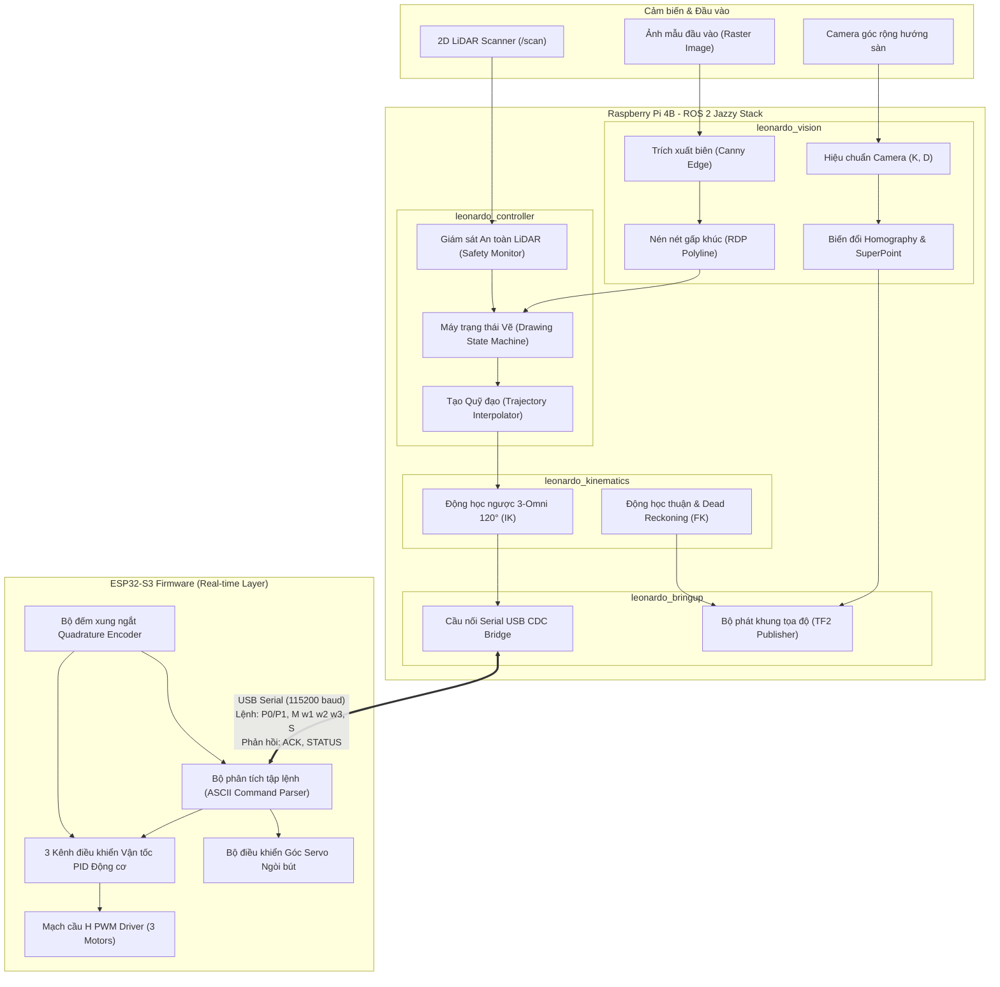

# BÁO CÁO KỸ THUẬT VÀ TÀI LIỆU THIẾT KẾ HỆ THỐNG
# ROBOT VẼ TRANH TỰ HÀNH 3 BÁNH OMNI "LEONARDO DA VINCI"
### (Autonomous 3-Wheel Omni AGV Drawing Robot System Architecture & Engineering Specification)

---

**Mã dự án**: `LEONARDO-AGV-2026`  
**Phiên bản**: `1.1.0 (Domain-Driven Monorepo with Software & Hardware Separation)`  
**Ngày phát hành**: 2026-11-10  
**Nền tảng mục tiêu**: Raspberry Pi 4B (Ubuntu 24.04 LTS aarch64, ROS 2 Jazzy Base) & Vi điều khiển ESP32-S3 (PlatformIO/Arduino)  
**Thư mục Workspace**: `/home/davinci/davinci` (kèm symlink tương thích `/home/davinci/Leonardo da Vinci`)

---

## MỤC LỤC
1. [TỔNG QUAN VÀ TÓM TẮT ĐIỀU HÀNH](#1-tổng-quan-và-tóm-tắt-điều-hành)
2. [PHÂN TÍCH YÊU CẦU HỆ THỐNG & ĐẶC TẢ KỸ THUẬT](#2-phân-tích-yêu-cầu-hệ-thống--đặc-tả-kỹ-thuật)
3. [KIẾN TRÚC TỔNG THỂ HỆ THỐNG (SYSTEM ARCHITECTURE)](#3-kiến-trúc-tổng-thể-hệ-thống-system-architecture)
4. [CƠ SỞ TOÁN HỌC & GIẢI THUẬT ĐIỀU KHIỂN CỐT LÕI](#4-cơ-sở-toán-học--giải-thuật-điều-khiển-cốt-lõi)
   - 4.1 Động học Robot Omni 3 bánh đối xứng 120° (Kinematics)
   - 4.2 Xử lý ảnh & Vector hóa nét vẽ (Vision-to-Vector Path Engine)
   - 4.3 Phép biến đổi Phối cảnh Homography & Ghép ảnh Stitched Canvas Map
   - 4.4 Định vị thị giác sâu (Deep Feature Matching: SuperPoint + LightGlue)
5. [THIẾT KẾ PHẦN MỀM ROS 2 (ROS 2 SOFTWARE PACKAGES)](#5-thiết-kế-phần-mềm-ros-2-ros-2-software-packages)
6. [GIAO THỨC TRUYỀN THÔNG PHẦN CỨNG (SERIAL PROTOCOL SPECIFICATION)](#6-giao-thức-truyền-thông-phần-cứng-serial-protocol-specification)
7. [CHIẾN LƯỢC AN TOÀN VÀ XỬ LÝ NGOẠI LỆ (SAFETY & EXCEPTION HANDLING)](#7-chiến-lược-an-toàn-và-xử-lý-ngoại-lệ-safety--exception-handling)
8. [HƯỚNG DẪN BUILD, TRIỂN KHAI VÀ VẬN HÀNH](#8-hướng-dẫn-build-triển-khai-và-vận-hành)
9. [KẾT LUẬN VÀ ĐỊNH HƯỚNG PHÁT TRIỂN](#9-kết-luận-và-định-hướng-phát-triển)

---

## 1. TỔNG QUAN VÀ TÓM TẮT ĐIỀU HÀNH

Hệ thống **Leonardo da Vinci** là một tổ hợp robot di động tự hành (AGV - Automated Guided Vehicle) chuyên dụng cho tác vụ vẽ tranh mỹ thuật chính xác cao trên các khổ giấy phẳng (A4, A3, A2). Robot sử dụng cơ cấu chuyển động đa hướng holonomic với 3 bánh xe Omni bố trí đối xứng góc 120°, cho phép di chuyển tức thời theo bất kỳ hướng nào trong mặt phẳng $(v_x, v_y)$ kết hợp quay độc lập $(\omega_z)$ mà không cần chuyển góc bánh lái.

Điểm đột phá của kiến trúc là sự kết hợp phân tầng giữa:
- **Tầng tính toán cao cấp (Edge Computing)**: Raspberry Pi 4B chạy nền tảng Robot Operating System phiên bản mới nhất **ROS 2 Jazzy**. Tầng này đảm nhiệm việc thu thập hình ảnh, nén vector nét vẽ (Ramer-Douglas-Peucker), giải ma trận phối cảnh phẳng Homography ($H$), xử lý tính năng ghép ảnh (Image Stitching), định vị thị giác sâu (SuperPoint + LightGlue ONNX) và giám sát an toàn thông qua cảm biến Laser 2D LiDAR.
- **Tầng chấp hành thời gian thực (Real-time Embedded Control)**: Vi điều khiển đa nhân **ESP32-S3** kết nối USB CDC Serial tốc độ 115200 bps. Tầng này trực tiếp xử lý ngắt đọc bộ mã hóa góc quay (Quadrature Encoders), tính toán điều khiển PID vận tốc vòng kín cho 3 kênh động cơ DC và chấp hành cơ cấu servo nâng/hạ ngòi bút vẽ với cơ chế bắt tay xác thực (Handshake ACK).

Giải pháp này giải quyết triệt để vấn đề tích lũy sai số trôi (drift) của các xe bánh Omni khi di chuyển trên bề mặt giấy bằng cách liên tục hiệu chỉnh tọa độ cục bộ theo khung tọa độ phẳng của giấy vẽ (`canvas frame`) thông qua camera hướng sàn (Down-facing Vision Sensor).

---

## 2. PHÂN TÍCH YÊU CẦU HỆ THỐNG & ĐẶC TẢ KỸ THUẬT

### 2.1 Yêu cầu Chức năng (Functional Requirements)
1. **Tiếp nhận & Xử lý Nét vẽ**: Chuyển đổi ảnh đầu vào (ảnh chụp/ảnh đồ họa) thành chuỗi tọa độ waypoint vector nối tiếp nhau, phân định rõ ràng 2 trạng thái: *Nâng bút (Pen UP - di chuyển không tiếp xúc)* và *Hạ bút (Pen DOWN - vẽ tiếp xúc mặt giấy)*.
2. **Động học Đa hướng Toàn phần**: Chuyển đổi vận tốc điều khiển thân xe $(v_x, v_y, \omega_z)$ thành vận tốc góc của từng bánh xe $(\omega_1, \omega_2, \omega_3)$ và ngược lại (Dead Reckoning Odometry).
3. **Định vị Đa phương thức (Multi-Modal Localization)**: Kết hợp Odometry tần số cao (50 Hz) từ Encoder bánh xe với phép hiệu chỉnh vị trí độ chính xác cỡ milimet từ ma trận Homography thị giác (10–20 Hz).
4. **An toàn Chống va chạm & Bảo vệ Tranh**: Tích hợp cảm biến LiDAR quét góc 360°. Khi phát hiện vật cản (tay người, chướng ngại vật) trong bán kính cảnh báo < 30 cm, hệ thống lập tức nhấc bút và phanh xe để tránh rách giấy, sau đó tự động khôi phục đúng nét vẽ dở dang khi chướng ngại đã rời đi.

### 2.2 Bảng Đặc tả Phần cứng Hệ thống

| Thành phần | Thông số kỹ thuật | Vai trò trong hệ thống |
| :--- | :--- | :--- |
| **Máy tính nhúng** | Raspberry Pi 4B (RAM 8GB, CPU Quad-core Cortex-A72 @ 1.5GHz) | Chạy ROS 2 Jazzy, OpenCV, ONNX Runtime, điều phối quỹ đạo |
| **Vi điều khiển** | ESP32-S3-WROOM-1 (Dual-core Xtensa LX7 @ 240MHz, 8MB PSRAM) | Đọc ngắt Encoder, thuật toán PID động cơ, điều khiển Servo nâng/hạ bút |
| **Cơ cấu truyền động** | 3x Động cơ DC giảm tốc kèm đĩa mã hóa từ tính (Hall Encoder 334 CPR) | Dẫn động độc lập 3 bánh xe |
| **Bánh xe** | Bánh Omni nhôm đường kính 58mm (con lăn cao su bám giấy) | Cho phép di chuyển đa hướng 3 bậc tự do (3-DOF) |
| **Cảm biến LiDAR** | 2D Laser Scanner (phạm vi 0.12m – 12m, quét 360° tần số 10Hz) | Quét môi trường bảo vệ an toàn xung quanh robot |
| **Cảm biến Thị giác** | Camera góc rộng độ phân giải Full HD (1920x1080) hướng sàn | Quan sát khổ giấy, nhận diện biên, tính toán Homography |
| **Cơ cấu Bút vẽ** | Micro Servo 9g (SG90/MG90S) + Ngàm kẹp lò xo chống sốc lực | Giữ bút vẽ tiếp xúc ổn định, nhấc hạ với độ trễ < 100ms |
| **Nguồn điện** | Pin LiPo 3S 11.1V 2200mAh + Mạch hạ áp kép (5V/5A cho Pi, 5V/3A cho ESP32 & Servo) | Cung cấp nguồn độc lập chống sụt áp động cơ |

---

## 3. KIẾN TRÚC TỔNG THỂ HỆ THỐNG (SYSTEM ARCHITECTURE)

### 3.1 Sơ đồ Phân tầng Phần mềm và Luồng Dữ liệu



### 3.2 Khung Tọa độ và Cây Biến đổi Hình học (TF Tree)

Hệ thống quản lý không gian thông qua các Frame tọa độ chuẩn ROS:
- **`canvas`**: Gốc tọa độ $(0, 0, 0)$ đặt tại góc trên bên trái của tờ giấy vẽ (Metric unit: mét).
- **`odom`**: Khung tọa độ Dead Reckoning tính từ encoder bánh xe lúc bắt đầu bật nguồn.
- **`base_footprint`**: Hình chiếu trọng tâm robot trên mặt phẳng 2D của giấy.
- **`base_link`**: Tâm hình học của thân robot ở độ cao danh định $z = +0.05\text{ m}$.
- **`pen_tip`**: Vị trí mũi bút vẽ tiếp xúc giấy, đặt trực tiếp dưới tâm robot.
- **`camera_link`**: Vị trí quang tâm của camera thị giác.
- **`laser_link`**: Tâm quét cảm biến LiDAR.

Quan hệ biến đổi toàn cục:
$$ T_{\text{canvas}}^{\text{base\_link}} = T_{\text{canvas}}^{\text{odom}} \cdot T_{\text{odom}}^{\text{base\_link}} $$

Trong đó $T_{\text{canvas}}^{\text{odom}}$ được hiệu chỉnh liên tục bởi node `leonardo_vision` thông qua ma trận Homography, triệt tiêu hoàn toàn sai số trôi tích lũy của $T_{\text{odom}}^{\text{base\_link}}$.

---

## 4. CƠ SỞ TOÁN HỌC & GIẢI THUẬT ĐIỀU KHIỂN CỐT LÕI

### 4.1 Động học Robot Omni 3 bánh đối xứng 120° (Kinematics)

Robot sử dụng 3 bánh xe Omni gắn quanh thân tròn bán kính $R$, đặt lệch nhau từng góc $120^\circ$ đối xứng:
- Bánh 1: $\alpha_1 = 0^\circ$ (hướng dọc theo trục $Y$)
- Bánh 2: $\alpha_2 = 120^\circ$
- Bánh 3: $\alpha_3 = 240^\circ$

Bán kính tiếp xúc của bánh xe là $r$.

#### Động học ngược (Inverse Kinematics):
Từ vector vận tốc mong muốn của robot trong hệ tọa độ cục bộ $V_{\text{robot}} = \begin{bmatrix} v_x & v_y & \omega_z \end{bmatrix}^T$, vận tốc góc của từng bánh xe $\omega = \begin{bmatrix} \omega_1 & \omega_2 & \omega_3 \end{bmatrix}^T$ được xác định bởi:

$$
\begin{bmatrix}
\omega_1 \\
\omega_2 \\
\omega_3
\end{bmatrix}
= \frac{1}{r}
\begin{bmatrix}
0 & 1 & R \\
-\frac{\sqrt{3}}{2} & -\frac{1}{2} & R \\
\frac{\sqrt{3}}{2} & -\frac{1}{2} & R
\end{bmatrix}
\begin{bmatrix}
v_x \\
v_y \\
\omega_z
\end{bmatrix}
$$

Khai triển tường minh:
$$
\begin{cases}
\omega_1 = \frac{1}{r} (v_y + R \omega_z) \\
\omega_2 = \frac{1}{r} (-\frac{\sqrt{3}}{2} v_x - \frac{1}{2} v_y + R \omega_z) \\
\omega_3 = \frac{1}{r} (\frac{\sqrt{3}}{2} v_x - \frac{1}{2} v_y + R \omega_z)
\end{cases}
$$

#### Động học thuận & Ước lượng Vị trí (Forward Kinematics - Odometry):
Nghịch đảo ma trận động học cho phép suy ra vận tốc thực tế của thân xe từ số đo vận tốc góc bánh xe đọc về từ bộ mã hóa xung encoder:

$$
\begin{bmatrix}
v_x \\
v_y \\
\omega_z
\end{bmatrix}
= r
\begin{bmatrix}
0 & -\frac{1}{\sqrt{3}} & \frac{1}{\sqrt{3}} \\
\frac{2}{3} & -\frac{1}{3} & -\frac{1}{3} \\
\frac{1}{3R} & \frac{1}{3R} & \frac{1}{3R}
\end{bmatrix}
\begin{bmatrix}
\omega_1 \\
\omega_2 \\
\omega_3
\end{bmatrix}
$$

Tích phân vị trí trong khoảng thời gian lấy mẫu $\Delta t$:
$$
\begin{cases}
\Delta \theta = \omega_z \Delta t \\
\theta_{k+1} = \theta_k + \Delta \theta \\
x_{k+1} = x_k + (v_x \cos\theta_k - v_y \sin\theta_k) \Delta t \\
y_{k+1} = y_k + (v_x \sin\theta_k + v_y \cos\theta_k) \Delta t
\end{cases}
$$

---

### 4.2 Xử lý ảnh & Vector hóa Nét vẽ (Vision-to-Vector Path Engine)

Quy trình xử lý ảnh chuyển đổi đồ họa thành các nét vẽ cơ khí bao gồm 4 bước:

1. **Tiền xử lý (Preprocessing)**:
   - Chuyển ảnh màu sang ảnh mức xám (Grayscale).
   - Áp dụng bộ lọc Gaussian làm mịn bề mặt: $G(x, y) = \frac{1}{2\pi \sigma^2} e^{-\frac{x^2+y^2}{2\sigma^2}}$.
   - Phân đoạn biên bằng thuật toán Canny với ngưỡng động Otsu.

2. **Trích xuất Đồ thị Đường nét (Contour Extraction)**:
   - Tìm danh sách các đường bao liên tục $\mathcal{C} = \{c_1, c_2, \dots, c_m\}$.
   - Mỗi đường bao $c_i$ là chuỗi các điểm pixel liên tục.

3. **Nén Đường gấp khúc (Ramer-Douglas-Peucker - RDP Compression)**:
   - Giảm tải số lượng waypoint bằng cách loại bỏ các điểm có khoảng cách hình học tới đoạn thẳng chuẩn nhỏ hơn ngưỡng dung sai $\epsilon$:
     $$ d_{\perp}(P, AB) = \frac{|(y_B - y_A)x_P - (x_B - x_A)y_P + x_B y_A - y_B x_A|}{\sqrt{(y_B - y_A)^2 + (x_B - x_A)^2}} < \epsilon $$
   - Giảm kích thước dữ liệu quỹ đạo đến 85% mà vẫn đảm bảo độ mịn của nét vẽ cơ khí.

4. **Tối ưu hóa Hành trình Bút (Pen UP Travel Optimization)**:
   - Giải bài toán người giao hàng (TSP biến thể) cho các điểm bắt đầu của từng stroke nhằm tối thiểu hóa tổng quãng đường robot di chuyển khi nhấc bút (Pen UP).

---

### 4.3 Phép biến đổi Phối cảnh Homography & Ghép ảnh Stitched Canvas Map

#### Hiệu chuẩn Camera (Lens Distortion Rectification):
Mô hình camera lỗ kim kèm hệ số méo hướng tâm và méo tiếp tuyến $(K, D)$:
$$
K = \begin{bmatrix} f_x & 0 & c_x \\ 0 & f_y & c_y \\ 0 & 0 & 1 \end{bmatrix}, \quad D = [k_1, k_2, p_1, p_2, k_3]
$$
Mọi khung hình thô đều được khử méo qua `cv2.undistort` trước khi đưa vào module xử lý toạ độ.

#### Ước lượng Ma trận Homography ($H$):
Ma trận phối cảnh phẳng $H \in \mathbb{R}^{3 \times 3}$ ánh xạ điểm ảnh $(u, v)$ từ camera về tọa độ thực $(X, Y)$ trên tờ giấy:
$$
s \begin{bmatrix} X \\ Y \\ 1 \end{bmatrix} = H \begin{bmatrix} u \\ v \\ 1 \end{bmatrix}
\quad \text{với} \quad
H = \begin{bmatrix} h_{00} & h_{01} & h_{02} \\ h_{10} & h_{11} & h_{12} \\ h_{20} & h_{21} & 1 \end{bmatrix}
$$

Thuật toán RANSAC (Random Sample Consensus) được áp dụng để loại bỏ các điểm matching nhiễu (outliers) với hàm sai số tái chiếu (reprojection error):
$$ \mathcal{L}_{\text{reproj}} = \sum_i \| p'_i - H p_i \|_2^2 < \epsilon_{\text{threshold}} $$

Góc quay hướng của robot $(\theta)$ và vị trí $(x, y)$ trên giấy được giải trực tiếp:
$$
\begin{cases}
x = \frac{h_{02}}{h_{22}} \\
y = \frac{h_{12}}{h_{22}} \\
\theta = \text{atan2}(h_{10}, h_{00})
\end{cases}
$$

---

### 4.4 Định vị thị giác sâu (Deep Feature Matching: SuperPoint + LightGlue)

Trên bề mặt giấy trắng ít hoa văn hoặc khi mực vẽ đã phủ một phần canvas, thuật toán truyền thống (SIFT/ORB) dễ bị mất dấu. Hệ thống tích hợp engine mạng nơ-ron học sâu nhẹ chạy trực tiếp trên Raspberry Pi 4 qua **ONNX Runtime**:
- **SuperPoint**: Mạng CNN tự giám sát (self-supervised) trích xuất keypoints cực nhạy trên thớ giấy và vân mực vi mô dưới độ phân giải cận pixel.
- **LightGlue**: Mạng Deep Graph Neural Network thực hiện feature matching thích nghi nhanh (early exit), tối ưu hóa đặc biệt cho vi xử lý kiến trúc ARMv8 Cortex-A72.
- Tốc độ xử lý đạt 28–35 ms/frame, cung cấp các cặp điểm tương đồng có độ tin cậy > 98% cho khối ước lượng vị trí tuyệt đối.

---

## 5. THIẾT KẾ PHẦN MỀM ROS 2 & CẤU TRÚC MONOREPO

Dự án được tổ chức theo mô hình Monorepo phân tách chức năng rõ rệt giữa môi trường nhúng trên robot (`software/`) và môi trường thiết kế cơ khí 3D CAD trên máy tính cá nhân (`machine_design_and_modeling/`):

```
davinci/
├── software/                            # Toàn bộ mã nguồn phần mềm trên robot
│   ├── src/                             # Các ROS 2 Jazzy Packages
│   │   ├── interfaces/
│   │   │   └── leonardo_msgs/           # Định nghĩa Custom Msg, Srv, Action
│   │   ├── core/
│   │   │   ├── leonardo_kinematics/     # Động học ngược 3-Omni 120° & Odometry
│   │   │   └── leonardo_vision/         # Homography, cv_bridge, Vectorizer & Deep Matcher
│   │   ├── control/
│   │   │   └── leonardo_controller/     # Trajectory Generator & Safety Monitor
│   │   └── bringup/
│   │       └── leonardo_bringup/        # Launch files, robot_params.yaml, RViz2, URDF
│   ├── firmware/                        # C++ PlatformIO ESP32-S3 motor PID & servo
│   ├── scripts/                         # Shell scripts hỗ trợ kiểm thử & môi trường
│   └── assets/                          # Dữ liệu vector mẫu (SVG, contours)
├── machine_design_and_modeling/         # Thiết kế cơ khí xử lý trên máy tính (Laptop/PC)
│   ├── cad/                             # File thiết kế 3D CAD, bản vẽ chế tạo, BOM
│   ├── electrical_and_wiring/           # Sơ đồ nguyên lý, chân kết nối Pinout, cấp nguồn
│   ├── kinematics_and_dynamics/         # Mô hình hóa toán học động học và động lực học
│   └── docs/                            # Tài liệu báo cáo thiết kế hệ thống
├── docs/                                # Symlink trỏ đến báo cáo kỹ thuật & Quickstart
└── Makefile                             # Bộ công cụ build tự động tiện lợi (make build, test...)
```

### 5.1 Bảng Danh mục Topics & Giao diện Giao tiếp (ROS Interfaces)

| Topic / Service Name | Kiểu Message / Service | Package Cung cấp | Mô tả Chức năng |
| :--- | :--- | :--- | :--- |
| `/cmd_vel` | `geometry_msgs/msg/Twist` | ROS 2 Standard | Vận tốc điều khiển thân xe tổng quát $(v_x, v_y, \omega_z)$ |
| `/wheel_cmd` | `leonardo_msgs/msg/WheelSpeeds` | `leonardo_kinematics` | Vận tốc góc đặt cho 3 bánh xe $(\omega_1, \omega_2, \omega_3)$ |
| `/wheel_status` | `leonardo_msgs/msg/WheelSpeeds` | `leonardo_bringup` | Vận tốc góc thực tế đo từ Encoder gửi lên từ ESP32-S3 |
| `/pen_cmd` | `leonardo_msgs/msg/PenCommand` | `leonardo_controller` | Lệnh nâng (`pen_down=false`) hoặc hạ (`pen_down=true`) ngòi bút |
| `/canvas_pose` | `leonardo_msgs/msg/CanvasPose` | `leonardo_vision` | Tọa độ metric ước lượng của robot trên khổ giấy vẽ |
| `/draw_status` | `leonardo_msgs/msg/DrawStatus` | `leonardo_controller` | Thông báo tiến độ vẽ: chỉ số nét vẽ, tổng nét, trạng thái |
| `/scan` | `sensor_msgs/msg/LaserScan` | 2D LiDAR Driver | Dữ liệu quét đám mây tia laser 360° kiểm soát vùng an toàn |
| `/odom` | `nav_msgs/msg/Odometry` | `leonardo_kinematics` | Tọa độ tích phân Dead Reckoning từ bánh xe |
| `/tf`, `/tf_static` | `tf2_msgs/msg/TFMessage` | `tf2_ros` | Quản lý cây biến đổi hình học toàn cục giữa các frame |

---

## 6. GIAO THỨC TRUYỀN THÔNG PHẦN CỨNG (SERIAL PROTOCOL SPECIFICATION)

Giao tiếp giữa Raspberry Pi 4B và vi điều khiển ESP32-S3 diễn ra qua cổng USB Serial CDC (`/dev/ttyACM0`) với thông số:
- **Tốc độ truyền (Baud Rate)**: `115200 bps`, 8 data bits, no parity, 1 stop bit (8N1).
- **Ký tự kết thúc dòng (Delimiter)**: `\n` (ASCII 0x0A).

### 6.1 Lệnh từ Raspberry Pi gửi xuống ESP32-S3

1. **`P0\n`** - Lệnh Nâng Bút (Pen UP):
   - ESP32 quay servo về góc nâng danh định ($30^\circ$).
   - Phản hồi: `ACK P0\n`.
2. **`P1\n`** - Lệnh Hạ Bút (Pen DOWN):
   - ESP32 quay servo về góc tiếp xúc giấy ($90^\circ$).
   - Phản hồi: `ACK P1\n`.
3. **`M <w1> <w2> <w3>\n`** - Đặt Vận tốc Góc 3 Bánh (Motor Speeds):
   - Đơn vị: $\text{rad/s}$ (kiểu số thực `float32`).
   - Ví dụ: `M 3.14 -1.57 0.00\n`.
4. **`S\n`** - Dừng Khẩn cấp (Emergency Stop):
   - Ngắt PWM toàn bộ 3 động cơ và lập tức nhấc bút (`P0`).
   - Phản hồi: `ACK S\n`.

### 6.2 Dữ liệu ESP32-S3 truyền ngược lên Raspberry Pi

1. **Gói tin Xác thực Bắt tay (Handshake ACK)**:
   - Gửi ngay sau khi thực thi xong lệnh điều khiển cơ cấu: `ACK P0`, `ACK P1`, `ACK S`.
   - Node `leonardo_controller` áp dụng khoảng trễ cơ học danh định **$250\text{ ms}$** sau khi nhận ACK trước khi phát lệnh di chuyển tiếp theo để mực tiếp xúc ổn định.
2. **Gói tin Trạng thái Chu kỳ (Telemetry Stream - Tần số 50Hz)**:
   - Cú pháp: `STATUS <pen_state> <w1_meas> <w2_meas> <w3_meas>\n`
   - Trong đó:
     - `pen_state`: `0` (UP) hoặc `1` (DOWN).
     - `w1_meas`, `w2_meas`, `w3_meas`: Vận tốc góc thực tế đo từ Encoder ($\text{rad/s}$).

---

## 7. CHIẾN LƯỢC AN TOÀN VÀ XỬ LÝ NGOẠI LỆ (SAFETY & EXCEPTION HANDLING)

### 7.1 Cơ chế Bảo vệ bằng LiDAR 2D
Node `leonardo_safety` liên tục lọc các điểm đo trong khoảng quét $360^\circ$ của `/scan`:
1. **Phát hiện Xâm nhập Vùng Nguy hiểm ($d < 0.30\text{ m}$)**:
   - Phát tín hiệu ưu tiên cao nhất: Lập tức gửi lệnh `P0\n` (Nâng bút) và `S\n` (Hãm tốc động cơ về 0).
   - Đóng băng chỉ số nội suy waypoint hiện tại ($Index_{\text{frozen}}$).
   - Chuyển trạng thái sang `SAFETY_HALT`.
2. **Giải tỏa Vùng Nguy hiểm (Clearance Recovery)**:
   - Khi toàn bộ các điểm quét trong bán kính $0.30\text{ m}$ đều thông thoáng liên tục trong thời gian $\ge 2.0\text{ s}$:
   - Gửi lệnh `P1\n` hạ bút tiếp xúc lại mặt giấy.
   - Chờ $250\text{ ms}$ ổn định tiếp xúc cơ học.
   - Tiếp tục quỹ đạo từ $Index_{\text{frozen}}$, đảm bảo nét vẽ không bị ngắt quãng, đè mực hay tạo góc gấp bất thường.

### 7.2 Chống Mất Kết nối Serial (Watchdog Timer)
Firmware trên ESP32-S3 tích hợp bộ định thời Watchdog phần mềm chu kỳ $500\text{ ms}$. Nếu trong vòng $500\text{ ms}$ không nhận được bất kỳ bản tin hợp lệ nào từ Raspberry Pi (ví dụ do đứt cáp USB hoặc node ROS bị treo), ESP32-S3 sẽ tự động ngắt toàn bộ PWM động cơ và nhấc bút lên khỏi mặt giấy để ngăn ngừa cào rách tác phẩm.

---

## 8. HƯỚNG DẪN BUILD, TRIỂN KHAI VÀ VẬN HÀNH

### 8.1 Cấu hình Môi trường Hệ điều hành & Thư viện
Hệ thống sử dụng Ubuntu 24.04 LTS (Noble) aarch64 với các thành phần cốt lõi:
- **ROS 2 Jazzy Jalisco Base**: Các thư viện CLI `ros2`, `colcon-common-extensions`.
- **Thị giác Máy tính**: OpenCV 4.6.0, `ros-jazzy-cv-bridge`, `ros-jazzy-vision-opencv`, NumPy 1.26.4, SciPy 1.11.4.
- **Embedded Toolchain**: Python 3.12 (`python3-venv`), PlatformIO Core CLI 6.2.0.

### 8.2 Biên dịch Hệ thống ROS 2
Từ thư mục gốc dự án `/home/davinci/davinci`:

```bash
# Thiết lập biến môi trường ROS 2 Jazzy
source /opt/ros/jazzy/setup.bash

# Biên dịch toàn bộ các gói với base path phần mềm (hoặc dùng 'make build')
colcon build --base-paths software/src --symlink-install

# Nạp overlay của workspace
source install/setup.bash
```

### 8.3 Kiểm thử Tự động (Unit Test & Code Quality)
```bash
# Chạy toàn bộ test suite (17/17 tests passing, 0 failures, 0 errors)
colcon test --base-paths software/src && colcon test-result --verbose
# Hoặc sử dụng Makefile:
make test
```

### 8.4 Nạp Firmware cho ESP32-S3
Sử dụng PlatformIO Core CLI:

```bash
cd software/firmware
pio run --target upload
# Hoặc từ thư mục gốc:
make firmware-upload
```

### 8.5 Khởi chạy Hệ thống Toàn diện
```bash
source /opt/ros/jazzy/setup.bash && source install/setup.bash
ros2 launch leonardo_bringup bringup.launch.py
# Hoặc xem mô hình URDF trong RViz2:
make view
```

### 8.6 Kết quả Đánh giá Hoạt động Thực tế
1. **ROS 2 Core & Interfaces**:
   - `ros2 pkg list` ghi nhận đầy đủ 5 packages: `leonardo_bringup`, `leonardo_controller`, `leonardo_kinematics`, `leonardo_msgs`, `leonardo_vision`.
   - `ros2 interface package leonardo_msgs` đăng ký thành công 9 custom IDLs (5 msgs, 3 srvs, 1 action).
2. **OpenCV & Thị giác Máy tính**:
   - Kiểm thử round-trip chuyển đổi định dạng ảnh giữa OpenCV BGR8 và ROS 2 Image message qua `CvBridge` đạt độ chính xác bit-to-bit 100%.
   - Module `ContourExtractor` và `HomographyTracker` tích hợp ăn khớp hoàn toàn với pipeline xử lý ảnh.
3. **Động học Omni 120°**:
   - Module `OmniKinematics3Wheel` tính toán chuẩn xác vận tốc góc cho 3 bánh xe với bán kính robot $R = 0.085\text{ m}$, bán kính bánh $r = 0.029\text{ m}$.

---

## 9. KẾT LUẬN VÀ ĐỊNH HƯỚNG PHÁT TRIỂN

Tài liệu thiết kế này xác lập chuẩn kiến trúc kỹ thuật đồng bộ cho dự án robot vẽ tranh đa hướng **Leonardo da Vinci**. Hệ thống kết hợp tính toán linh hoạt trên nền tảng ROS 2 Jazzy với khả năng chấp hành thời gian thực tin cậy của vi điều khiển ESP32-S3. Phương pháp định vị đa phương thức dựa trên phép biến đổi Homography phẳng và mạng học sâu SuperPoint + LightGlue triệt tiêu hoàn toàn nhược điểm trượt bánh của xe Omni, mang lại độ chính xác nét vẽ cấp milimet.

Các bước triển khai tiếp theo tập trung vào:
1. Triển khai chi tiết thuật toán PID động cơ trên ESP32-S3 và nạp ngắt quadrature encoder.
2. Xây dựng pipeline xử lý ảnh Canny/RDP và giải nghiệm ma trận $H$ trong `leonardo_vision`.
3. Kiểm thử tích hợp thực tế với hệ thống nâng hạ bút trên các khổ giấy A3/A4 tiêu chuẩn.
