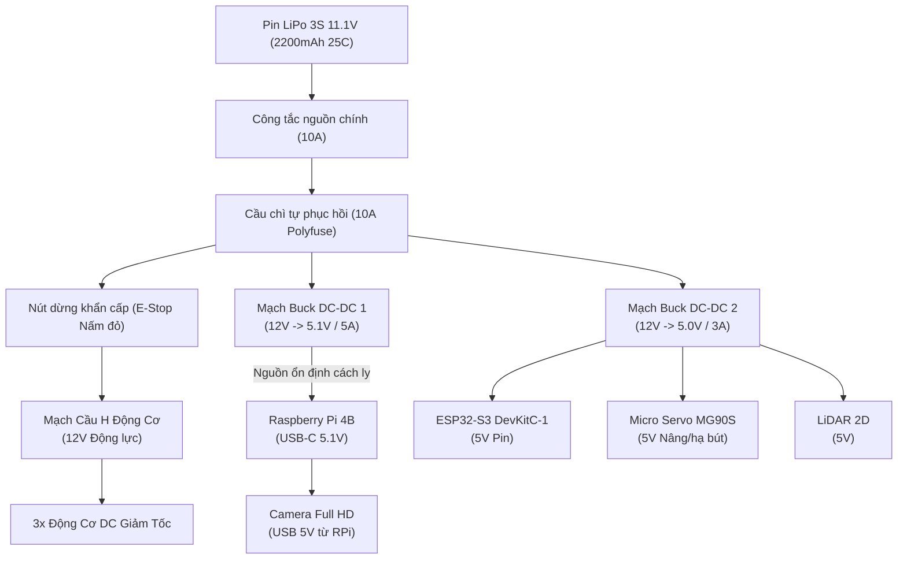

# Sơ Đồ Cấp Nguồn & Đấu Nối Điện (Power Architecture & Wiring)

Tài liệu này hướng dẫn thiết kế mạch phân phối nguồn điện, bảo vệ chống sụt áp và sơ đồ đấu nối toàn hệ thống **Leonardo da Vinci**.

---

## 1. Sơ Đồ Khối Cấp Nguồn (Power Distribution Architecture)

---

## 2. Chiến Lược Cách Ly Nguồn & Chống Sụt Áp (Noise Isolation)

Khi 3 động cơ DC khởi động hoặc đảo chiều đột ngột, dòng khởi động tức thời có thể đạt đỉnh tới **$3.5\text{ A}$**, gây sụt áp trên đường nguồn 12V:
1. **Phân nhánh độc lập**: Nguồn $12\text{V}$ được tách làm 3 nhánh riêng biệt ngay sau cầu chì chính:
   - **Nhánh Động cơ (12V Motor Driver)**: Cấp thẳng cho chân VM của mạch cầu H qua công tắc E-Stop. Tích hợp tụ điện hóa lọc nguồn $1000\mu\text{F} / 25\text{V}$ đặt sát chân linh kiện cầu H.
   - **Nhánh Tính toán Cao cấp (Buck 1 - 5.1V/5A)**: Cấp độc lập cho Raspberry Pi 4B qua cổng USB-C. Điện áp đặt ở $5.1\text{V}$ để bù hao tổn điện áp trên dây dẫn, ngăn chặn triệt để cảnh báo `Undervoltage detected` của Raspberry Pi.
   - **Nhánh Vi điều khiển & Ngoại vi (Buck 2 - 5.0V/3A)**: Cấp cho chân 5V của ESP32-S3, cuộn dây Servo MG90S và cảm biến LiDAR.
2. **Điểm nối đất chung (Star Grounding Topology)**: Toàn bộ dây GND (GND Pin, GND Motor Driver, GND Logic RPi, GND ESP32) được đấu tập trung tại một điểm Ground duy nhất gần cọc âm của pin nhằm triệt tiêu vòng lặp dòng xoáy đất (Ground loop) gây nhiễu tín hiệu ngắt Encoder.

---

## 3. Mạch Dừng Khẩn Cấp (Hardware Emergency Stop)

Nút dừng khẩn cấp cơ học (E-Stop):
- Được đấu nối tiếp trực tiếp trên đường cấp nguồn $12\text{V}$ tới chân VM của mạch cầu H.
- Khi người vận hành nhấn nút nấm đỏ: Nguồn cấp cho toàn bộ động cơ bị ngắt vật lý ngay lập tức trong thời gian $< 5\text{ ms}$, xe dừng trôi tự do mà không làm treo hay tắt máy tính Raspberry Pi.
- Song song với tiếp điểm lực, một tiếp điểm phụ gửi tín hiệu logic về chân GPIO cảm biến của ESP32 để kích hoạt chương trình nhấc bút an toàn (`P0`).

---

## 4. Bảng Kết Nối Cáp Tín Hiệu (Signal Interconnection)

| Từ Thiết bị | Chân Tín hiệu | Đến Thiết bị | Giao thức / Định mức |
| :--- | :--- | :--- | :--- |
| **Raspberry Pi 4B** | Cổng USB 3.0 Type-A | **ESP32-S3** (USB CDC Port) | USB Serial 115200 bps |
| **Raspberry Pi 4B** | Cổng USB 2.0 | **LiDAR 2D** | USB Serial /dev/ttyUSB0 |
| **Raspberry Pi 4B** | Cổng USB 2.0 / CSI | **Camera Full HD** | V4L2 Video Stream |
| **ESP32-S3** | GPIO 4 | **Servo MG90S Signal** | Tín hiệu PWM 50Hz (Chu kỳ 20ms) |
| **ESP32-S3** | GPIO 5, 7, 9 | **Motor Driver PWM 1, 2, 3** | Tần số PWM 20kHz (LEDC Timer) |
| **ESP32-S3** | GPIO 6, 8, 10 | **Motor Driver DIR 1, 2, 3** | Mức Logic 3.3V (HIGH / LOW) |
| **ESP32-S3** | GPIO 11, 13, 15 | **Encoder Ch A (Motor 1,2,3)**| Tín hiệu ngắt sườn xung đếm |
| **ESP32-S3** | GPIO 12, 14, 16 | **Encoder Ch B (Motor 1,2,3)**| Đọc chiều quay quadrature |
