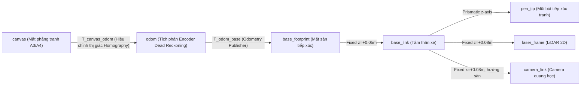

# Cơ Sở Toán Học Động Học & Động Lực Học (Kinematics & Dynamics Modeling)

Tài liệu này trình bày chi tiết các mô hình toán học giải tích, phương trình vi phân chuyển động, ước lượng Odometry và phép biến đổi tọa độ thị giác của robot **Leonardo da Vinci**.

---

## 1. Cấu Hình Hình Học Robot Omni 3 Bánh Đối Xứng 120°

Robot di chuyển trên mặt phẳng 2D $(O, X, Y)$ nhờ 3 bánh xe Omni bố trí cách đều một góc $120^\circ$ trên vòng tròn bán kính $R = 0.15\text{ m}$. Bán kính của mỗi bánh xe là $r = 0.029\text{ m}$.

Quy ước góc lắp đặt $\alpha_i$ của các bánh xe so với trục tiến $X$ của thân xe:
- **Bánh 1**: $\alpha_1 = 0^\circ$ (Trục quay song song với trục $X$, bánh lăn tạo lực đẩy theo trục $Y$).
- **Bánh 2**: $\alpha_2 = 120^\circ = \frac{2\pi}{3}\text{ rad}$.
- **Bánh 3**: $\alpha_3 = 240^\circ = \frac{4\pi}{3}\text{ rad}$.

Gọi vector vận tốc của robot trong hệ quy chiếu cục bộ (robot body frame) là:
$$V_{\text{robot}} = \begin{bmatrix} v_x \\ v_y \\ \omega_z \end{bmatrix}$$
trong đó:
- $v_x$: Vận tốc tịnh tiến dọc trục tiến $(\text{m/s})$.
- $v_y$: Vận tốc tịnh tiến ngang $(\text{m/s})$.
- $\omega_z$: Vận tốc góc quay quanh trục đứng $(\text{rad/s})$.

Vector vận tốc góc của 3 bánh xe là:
$$\omega_{\text{wheels}} = \begin{bmatrix} \omega_1 \\ \omega_2 \\ \omega_3 \end{bmatrix} \quad (\text{rad/s})$$

---

## 2. Mô Hình Động Học Ngược (Inverse Kinematics - IK)

Phương trình động học ngược tính toán vận tốc góc cần đặt cho từng bánh xe từ vận tốc mong muốn của thân xe:

$$
\omega_i = \frac{1}{r} \left( -\sin(\alpha_i) v_x + \cos(\alpha_i) v_y + R \omega_z \right)
$$

Biểu diễn dưới dạng ma trận:
$$
\begin{bmatrix}
\omega_1 \\
\omega_2 \\
\omega_3
\end{bmatrix}
= \frac{1}{r}
\begin{bmatrix}
-\sin(0^\circ) & \cos(0^\circ) & R \\
-\sin(120^\circ) & \cos(120^\circ) & R \\
-\sin(240^\circ) & \cos(240^\circ) & R
\end{bmatrix}
\begin{bmatrix}
v_x \\
v_y \\
\omega_z
\end{bmatrix}
= \frac{1}{r}
\begin{bmatrix}
0 & 1 & R \\
-\frac{\sqrt{3}}{2} & -\frac{1}{2} & R \\
\frac{\sqrt{3}}{2} & -\frac{1}{2} & R
\end{bmatrix}
\begin{bmatrix}
v_x \\
v_y \\
\omega_z
\end{bmatrix}
$$

Hệ phương trình khai triển:
$$
\begin{cases}
\omega_1 = \frac{1}{r} (v_y + R \omega_z) \\
\omega_2 = \frac{1}{r} \left( -\frac{\sqrt{3}}{2} v_x - \frac{1}{2} v_y + R \omega_z \right) \\
\omega_3 = \frac{1}{r} \left( \frac{\sqrt{3}}{2} v_x - \frac{1}{2} v_y + R \omega_z \right)
\end{cases}
$$

---

## 3. Mô Hình Động Học Thuận & Odometry (Forward Kinematics - FK)

Từ các vận tốc góc đo được từ bộ mã hóa xung (encoders) của 3 bánh xe $\omega = [\omega_1, \omega_2, \omega_3]^T$, vận tốc thực tế của thân xe được tính bằng nghịch đảo ma trận Jacobian động học $J^{-1}$:

$$
\begin{bmatrix}
v_x \\
v_y \\
\omega_z
\end{bmatrix}
= r
\begin{bmatrix}
0 & -\frac{1}{\sqrt{3}} & \frac{1}{\sqrt{3}} \\
\frac{2}{3} & -\frac{1}{3} & -\frac{1}{3} \\
\frac{1}{3R} & \frac{1}{3R} & \frac{1}{3R}
\end{bmatrix}
\begin{bmatrix}
\omega_1 \\
\omega_2 \\
\omega_3
\end{bmatrix}
$$

Hệ phương trình khai triển:
$$
\begin{cases}
v_x = \frac{r}{\sqrt{3}} (\omega_3 - \omega_2) \\
v_y = \frac{r}{3} (2\omega_1 - \omega_2 - \omega_3) \\
\omega_z = \frac{r}{3R} (\omega_1 + \omega_2 + \omega_3)
\end{cases}
$$

### Tích Phân Quỹ Đạo Vị Trí (Dead Reckoning Odometry Integration):
Tại chu kỳ lấy mẫu $\Delta t$, sự thay đổi tư thế trong hệ tọa độ toàn cục (`odom` frame):

$$
\begin{cases}
\Delta \theta = \omega_z \Delta t \\
\theta_{k+1} = \theta_k + \Delta \theta \\
\Delta x = (v_x \cos\theta_k - v_y \sin\theta_k) \Delta t \\
\Delta y = (v_x \sin\theta_k + v_y \cos\theta_k) \Delta t \\
x_{k+1} = x_k + \Delta x \\
y_{k+1} = y_k + \Delta y
\end{cases}
$$

---

## 4. Mô Hình Phép Biến Đổi Phối Cảnh Homography ($H$)

Bánh xe Omni có độ trượt (slip) tự nhiên khi di chuyển trên bề mặt giấy nhẵn, dẫn đến sai số Odometry tích lũy theo thời gian. Để đạt độ chính xác vẽ tuyệt đối $< 0.5\text{ mm}$, camera hướng sàn liên tục quan sát các điểm mốc trên mặt phẳng giấy và giải ma trận Homography phẳng $H \in \mathbb{R}^{3 \times 3}$:

$$
s \begin{bmatrix} X_{\text{canvas}} \\ Y_{\text{canvas}} \\ 1 \end{bmatrix}
= H
\begin{bmatrix} u \\ v \\ 1 \end{bmatrix}
\quad \text{với} \quad
H = \begin{bmatrix} h_{00} & h_{01} & h_{02} \\ h_{10} & h_{11} & h_{12} \\ h_{20} & h_{21} & 1 \end{bmatrix}
$$

### Khử méo quang học ống kính (Lens Rectification):
Ảnh thô được nắn thẳng thông qua ma trận thông số nội tại $K$ và vector hệ số méo $D$:
$$
K = \begin{bmatrix} f_x & 0 & c_x \\ 0 & f_y & c_y \\ 0 & 0 & 1 \end{bmatrix}, \quad D = [k_1, k_2, p_1, p_2, k_3]
$$

### Trích xuất vị trí và hướng tuyệt đối:
$$
\begin{cases}
x_{\text{robot}} = \frac{h_{02}}{h_{22}} \\
y_{\text{robot}} = \frac{h_{12}}{h_{22}} \\
\theta_{\text{robot}} = \text{atan2}(h_{10}, h_{00})
\end{cases}
$$

---

## 5. Cây Biến Đổi Tọa Độ Toàn Cục (TF Tree Architecture)

Phương trình tọa độ khép kín:
$$
T_{\text{canvas}}^{\text{pen\_tip}} = T_{\text{canvas}}^{\text{odom}} \cdot T_{\text{odom}}^{\text{base\_link}} \cdot T_{\text{base\_link}}^{\text{pen\_tip}}
$$
Nhờ cơ chế này, bất kỳ độ trôi bánh nào của $T_{\text{odom}}^{\text{base\_link}}$ đều được bù trừ ngay lập tức bởi cập nhật $T_{\text{canvas}}^{\text{odom}}$ từ module thị giác.
