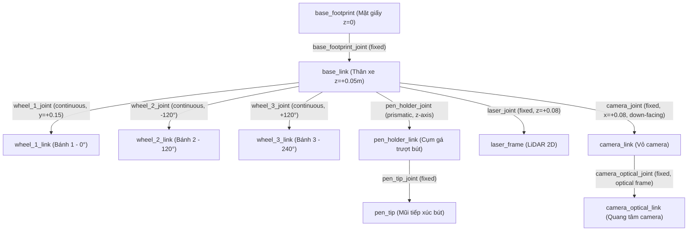

# Mô Hình Hóa Robot 3D URDF/Xacro (Robot Modeling)

Thư mục này chứa mô hình kinematic và dynamic 3D chuẩn hóa theo chuẩn ROS 2 của robot vẽ tranh đa hướng **Leonardo da Vinci**.

---

## 1. Cấu Trúc Khâu (Links) và Khớp Nối (Joints)

File mô tả chính: [`leonardo.urdf.xacro`](leonardo.urdf.xacro)



---

## 2. Thông Số Khớp Nối & Hình Học

| Link Name | Parent Link | Joint Type | Vị trí Origin $(x, y, z)$ | Hướng quay RPY $(\text{rad})$ | Ghi chú |
| :--- | :--- | :--- | :--- | :--- | :--- |
| `base_link` | `base_footprint` | `fixed` | `(0, 0, 0.05)` | `(0, 0, 0)` | Thân trụ tròn $\varnothing 300\text{ mm}$, cao $60\text{ mm}$ |
| `wheel_1_link` | `base_link` | `continuous` | `(0.0, 0.15, -0.021)` | `(0, 0, 0)` | Bánh Omni $\alpha_1 = 0^\circ$ (dọc trục Y) |
| `wheel_2_link` | `base_link` | `continuous` | `(-0.1299, -0.075, -0.021)` | `(0, 0, 2.0944)` | Bánh Omni $\alpha_2 = 120^\circ$ |
| `wheel_3_link` | `base_link` | `continuous` | `(0.1299, -0.075, -0.021)` | `(0, 0, -2.0944)` | Bánh Omni $\alpha_3 = 240^\circ$ |
| `pen_holder_link`| `base_link` | `prismatic` | `(0, 0, 0)` | `(0, 0, 0)` | Hành trình trượt nâng hạ $z \in [-15, +15]\text{ mm}$ |
| `pen_tip` | `pen_holder_link`| `fixed` | `(0, 0, -0.04)` | `(0, 0, 0)` | Vị trí tiếp xúc ngòi mực với mặt giấy |
| `laser_frame` | `base_link` | `fixed` | `(0, 0, 0.08)` | `(0, 0, 0)` | Trụ quét laser LiDAR $360^\circ$ |
| `camera_link` | `base_link` | `fixed` | `(0.08, 0, -0.02)` | `(0, 1.5708, 0)` | Cụm camera quay hướng sàn |
| `camera_optical_link`| `camera_link` | `fixed`| `(0, 0, 0)` | `(-1.5708, 0, -1.5708)`| Chuẩn quang học (Z tiến, X sang phải, Y xuống) |

---

## 3. Khởi Chạy & Kiểm Tra Mô Hình

Để biên dịch xacro sang URDF thuần túy và kiểm tra cấu trúc cú pháp:
```bash
# Kiểm tra cú pháp xacro
xacro machine_design_and_modeling/urdf/leonardo.urdf.xacro > /tmp/leonardo.urdf
check_urdf /tmp/leonardo.urdf

# Hiển thị biểu đồ cây TF và các khớp
urdf_to_graphiz /tmp/leonardo.urdf
```

Khởi chạy mô hình trực quan kèm thanh trượt điều khiển khớp (`joint_state_publisher_gui`) và RViz2:
```bash
make view
# hoặc
ros2 launch leonardo_bringup view_robot.launch.py
```
